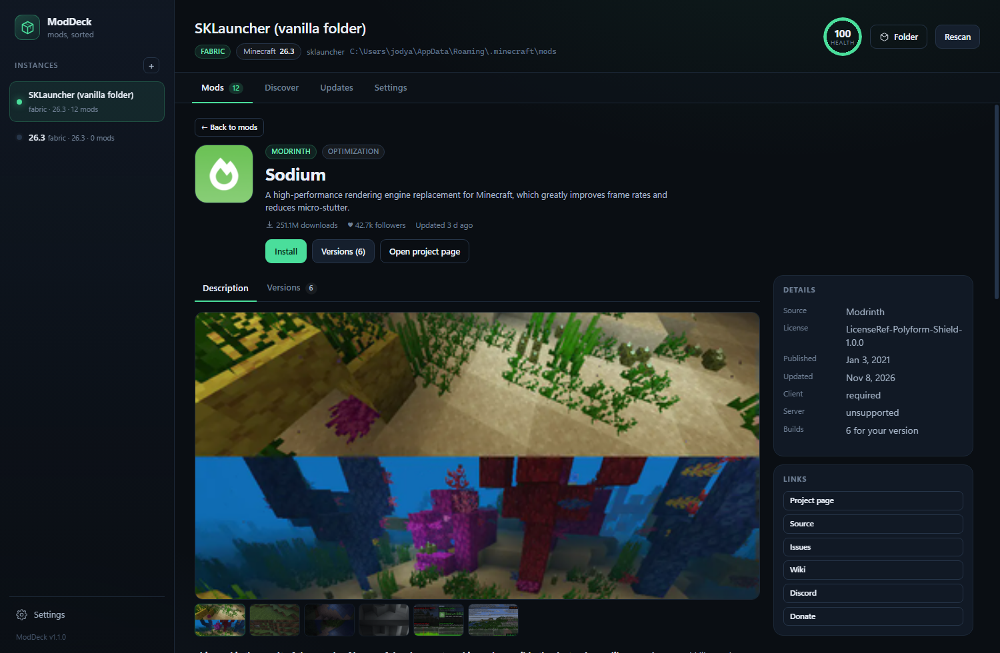

# ModDeck

**A local, no-nonsense Minecraft mod manager for SKLauncher, PollyMC / Prism / MultiMC, and any
custom instance folder.** It reads the jars you already have, explains what might break, and
installs new mods from Modrinth (and CurseForge if you add a key) — without launcher lock-in and
without uploading your setup anywhere.



- **Two ways to run:** a lightweight `.bat` (Python only, no install) or a single native
  `ModDeck.exe` with a real desktop window.
- **Honest health checks:** real metadata, not filenames — duplicates, missing dependencies,
  loader/version mismatches, known-bad pairs.
- **Store-style project pages:** descriptions, galleries, versions and one-click installs.
- **Nothing destructive by accident:** every removal goes to a recoverable trash.

> **Built by vibe coding.** ModDeck was designed and written in a conversation with
> **[OpenCode](https://opencode.ai)**, an open-source AI coding agent — with a human (Sorheim)
> steering, testing and saying "actually, make it native". Credit where it's due: see
> [Credits & attribution](#credits--attribution).

---

## Install

### Option A: the executable (recommended for players)

1. Download `ModDeck.exe` from the [latest release](../../releases/latest).
2. Run it. That's it — no Python, no installer.

It opens a native window through Edge **WebView2** (already present on Windows 10/11) and keeps
its settings, cache, log and trash in `%LOCALAPPDATA%\ModDeck\`. You can move or delete the exe
without losing your data.

### Option B: run from source (hackers and tinkerers)

Requires **Python 3.11+** (for `tomllib`). No `pip install`, no `npm install`, no build step:

```bat
ModDeck.bat
```

It starts a server on `127.0.0.1` and opens the UI in an Edge app window (falls back to your
default browser). Use `ModDeck-debug.bat` to keep a console open; logs also go to `data/moddeck.log`.

### Build the exe yourself

```bat
build_exe.bat
```

Creates an isolated `.build-venv`, installs `pywebview` + `pyinstaller` there, generates the icon
if needed, and writes `dist\ModDeck.exe`. The runtime app itself still uses only the Python
standard library.

---

## What it does

### Mods tab

- Reads each jar's **own metadata** — `fabric.mod.json`, `quilt.mod.json`, `META-INF/mods.toml`,
  `META-INF/neoforge.mods.toml`, `mcmod.info` — not the filename.
- Shows the real mod id, version, loader, environment (client/server/both), authors and declared
  dependencies.
- **Health check** flags:
  - duplicate mod ids (two versions of the same mod loaded at once)
  - missing **required** dependencies (Fabric API modules count as satisfied when Fabric API is installed)
  - declared `breaks` / `conflicts` — only when the installed version is inside the broken range
  - loader mismatch (a Forge jar in a Fabric instance)
  - Minecraft version mismatch (warning, not an error)
  - jars with no metadata / resource packs in the mods folder
  - duplicate mixin config names
  - a small list of known-bad pairs (OptiFine + Sodium, Starlight + Phosphor, …)
- Source links, sizes, and one-click **Disable / Enable / Remove**.
- Bulk select and disable.

### Discover

- Search Modrinth or CurseForge, automatically filtered to **your loader + Minecraft version**.
- **Click any result to open its full project page**: description, screenshots/gallery, categories,
  licence, client/server side, links, downloads and every compatible build.
- **Description** and **Versions** tabs; install from either one.
- Installs the file, verifies its **SHA-1**, and can pull required dependencies automatically.
- If a Fabric mod needs `fabric-*` API modules, **Fabric API is installed automatically**.
- If a CurseForge author disabled third-party downloads, ModDeck tells you and links to the page.

### Updates

- Identifies installed jars by **SHA-1** against Modrinth — works even for renamed files.
- Lists newer builds that support your exact loader and Minecraft version; prefers stable releases
  and never offers a downgrade over an installed beta.
- "Update all" replaces jars in place; old ones go to trash. Duplicate copies are left alone so
  they can't multiply.

### Disabling and deleting

- Disabling moves a jar to `mods.disabled/` next to `mods/`.
- After disabling, ModDeck can **offer to move the disabled jar to the trash** — handy right after
  swapping in an update. Keep it if you might roll back, or delete it in one click.
- The prompt has a **"Don't ask me again"** checkbox; the same option lives in
  **Settings → Behaviour**.
- **Settings → Trash** lists everything with size and age. Restore a jar to the current instance,
  delete one file forever, or empty the whole trash — each with confirmation.

### Instances

- Auto-detects `%APPDATA%\.minecraft` (SKLauncher), PollyMC / Prism / MultiMC instances.
- Add any other folder with **+** in the sidebar (native folder picker included).
- Override the target Minecraft version/loader from the header — useful for SKLauncher, where one
  `mods` folder is shared across versions.

---

## Safety model

Nothing is hard-deleted by accident:

| Action | What actually happens |
|---|---|
| Disable | jar moves to `mods.disabled/` next to `mods/` |
| Enable | jar moves back to `mods/` |
| Remove | jar moves to the trash (`<data dir>/trash/<timestamp>/<instance>/`) |
| Update | old jar moves to trash, new jar downloaded and SHA-1 verified |
| Empty trash | the only permanent delete, always behind a confirmation |

The app listens only on `127.0.0.1`, requires a per-run random token for every write request, and
never uploads your mod list or instance paths anywhere.

---

## Limitations (read this once)

- A green score means **"nothing obviously wrong in the metadata"**, not a guarantee. ModDeck
  cannot detect class-level mixin clashes, runtime bugs, or config conflicts.
- Version ranges in `breaks` are best-effort Maven/semver parsing; weird custom version strings may
  be judged incorrectly. Warnings are deliberately conservative.
- CurseForge requires a free API key (`console.curseforge.com`), stored locally in `settings.json`.
- Fabric mods that depend on individual `fabric-*` modules are treated as satisfied when Fabric API
  is present.
- Modrinth is the only source for hash-based update detection.
- Project descriptions are rendered from Markdown/HTML with a small safe renderer. Remote images
  load from Modrinth/CurseForge CDNs; nothing is executed.

---

## Files

```
ModDeck/
  ModDeck.bat          double-click launcher (no console)
  ModDeck-debug.bat    same, with console + logs
  build_exe.bat        builds dist\ModDeck.exe
  desktop.py           native-window entry point (pywebview / WebView2)
  server.py            backend: scanning, analysis, Modrinth/CurseForge, file ops
  tools/make_icon.py   generates web\icon.ico
  web/                 UI (index.html, style.css, app.js, favicon.svg, icon.ico)
  docs/                screenshots
  data/                settings, cache, trash, log (source version, git-ignored)
```

The exe keeps the same files in `%LOCALAPPDATA%\ModDeck\`.

Stop it with **Settings → Quit ModDeck**, or just close the window.

---

## Credits & attribution

ModDeck is a **vibe-coded project**: it was built in a live session with
**[OpenCode](https://opencode.ai)**, an open-source AI coding agent, at the direction of
**Sorheim**. Every feature — the jar parser, the health checks, the project pages, the native
window, the trash model, this README — came out of that collaboration.

**If you fork, remix, bundle or redistribute ModDeck, or build something derived from it, please
credit it clearly:**

> Based on **ModDeck** by **Sorheim**, originally built with **[OpenCode](https://opencode.ai)**.

Keep the MIT copyright notice, and link back to this repository where practical. That's the whole
ask — no permission needed beyond that, go make something good.

### Thanks

- [Modrinth](https://modrinth.com) and [CurseForge](https://www.curseforge.com) for their public APIs.
- [pywebview](https://pywebview.flowrl.com) and PyInstaller for making the native window possible.
- The Fabric, Quilt, Forge and NeoForge modding communities, whose metadata formats this tool reads.

ModDeck is not affiliated with Mojang, Microsoft, Modrinth, CurseForge, or any launcher vendor.
"Minecraft" is a trademark of Mojang Synergies AB.

---

## Licence

[MIT](LICENSE) © 2026 Sorheim
